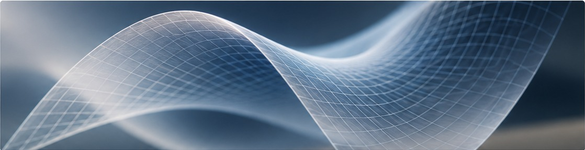

  

# Welcome

I am a PhD candidate in pure mathematics at [**Sorbonne Université**](https://www.sorbonne-universite.fr), under the supervision of [**Andrés Sambarino**](https://sambarino-andres.apps.math.cnrs.fr). I completed my Master degree at **Université Sorbonne Paris Nord** in 2024 and another one at **AIMS-Cameroon** in 2023 under the supervision of  **Prof. Dr. Hans-Georg Rück**.

My research interests lie at the intersection of **Higher Teichmüller theory, Higgs bundles, and geometric analysis**. I am particularly interested in:

- Anosov representations and Higher Teichmüller Theory;
- Higgs bundles;
- minimal surfaces and harmonic maps;
- thermodynamic formalism;
- Ultraproduct and Building;'
- geometric analysis;
- PVHS, (G,P)-opers, Chern Simon and Chern-Weil theory.

I am currently also learning things related to the spectrum of Anosov representations.

For academic enquiries, please contact me at [doba@imj-prg.fr](doba@imj-prg.fr) or [barthelemy.doba@sorbonne-universite.fr](barthelemy.doba@sorbonne-universite.fr).
